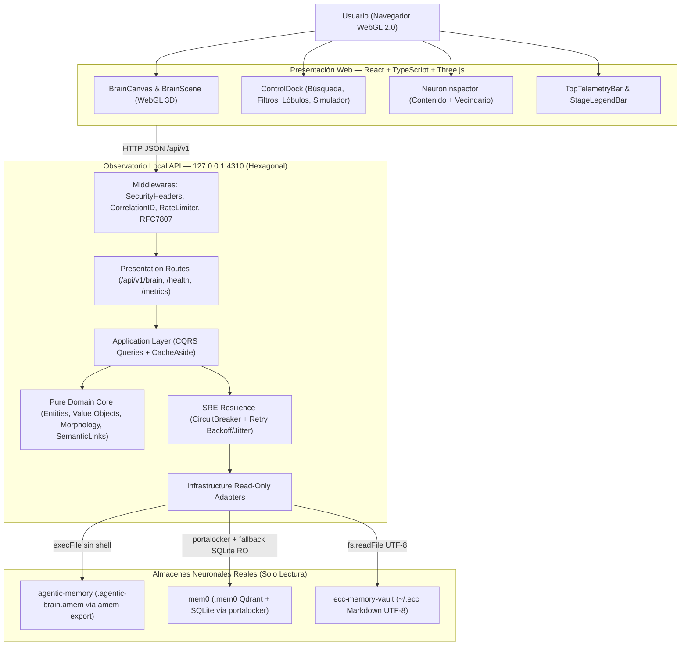

# Fase 2 — Arquitectura del Sistema (High-Level, C4, Hexagonal y Resiliencia SRE)

**Proyecto:** Neural Brain Visualizer (`neural-brain-visualizer`)  
**Versión:** 1.0.0  
**Fecha:** 2026-11-19  

---

## 1. Diagrama de Arquitectura High-Level

---

## 2. Modelo C4 — Contenedores y Componentes

### 2.1 Nivel 1 (Contexto) y Nivel 2 (Contenedores)
- **Contenedor Web SPA (`src/web/`):** Aplicación React + TypeScript compilada con Vite que renderiza un cerebro humano 3D anatómico con Three.js y ofrece controles de búsqueda, filtrado, enfoque por lóbulos e inspección de memoria.
- **Contenedor Backend Observatorio (`src/presentation/`, `src/application/`, `src/domain/`, `src/infrastructure/`):** Servidor HTTP Node.js/TypeScript ligero vinculado estrictamente a `127.0.0.1:4310`. En producción sirve tanto la API REST `/api/v1/*` como los activos estáticos compilados de `dist/web`.

### 2.2 Arquitectura Hexagonal y Reglas de Dependencia (ADP / SDP / SAP)
El proyecto aplica estrictamente la inversión de dependencias y los principios de componentes (**REP, CCP, CRP, ADP, SDP, SAP**):
- **`src/domain/`**: Núcleo puro. **0 importaciones** de `application`, `infrastructure`, `presentation`, `web`, `fs`, `child_process` o `http`. Define Entidades inmutables, Value Objects, Servicios de Dominio y Puertos (`MemoryStorePort`, `LoggerPort`).
- **`src/application/`**: Casos de uso de lectura (patrón **CQRS Query**) y DTOs inmutables. Depende **únicamente** de `src/domain/`.
- **`src/infrastructure/`**: Adaptadores concretos (`AgenticMemoryAdapter`, `Mem0Adapter`, `EccVaultAdapter`), configuración Fail-Fast (`Zod`), logger JSON y patrones SRE (`CircuitBreaker`, `RetryPolicy`, `CacheAside`, `RateLimiter`). Implementa los puertos del dominio.
- **`src/presentation/`**: Rutas HTTP, validación Zod de parámetros de entrada, correlación `X-Correlation-ID`, cabeceras de seguridad y manejador global RFC 7807.

Estas fronteras se validan automáticamente en CI/CD mediante **Fitness Functions** en [`tests/architecture/fitness.test.ts`](../tests/architecture/fitness.test.ts).

---

## 3. Diseño de Morfología Cerebral 3D Adaptativa

La geometría del cerebro (`src/web/brain3d/brainGeometry.ts` + `src/domain/services/BrainMorphologyService.ts`) proyecta el volumen real de datos en parámetros anatómicos continuos:

| Etapa (`GrowthStage`) | Rango de Neuronas | Escala Cortical | Profundidad Surcos/Giros | Opacidad Corteza | Comportamiento Visual |
|---|---|---|---|---|---|
| **Corteza Embrionaria** (`embryonic`) | 0 – 19 | `0.78x` | `0.25` | `0.14` | Silueta cerebral translúcida incipiente, pocos tractos primarios, neuronas núcleo destacadas. |
| **Corteza en Desarrollo** (`developing`) | 20 – 59 | `0.92x` | `0.55` | `0.22` | Hemisferios diferenciados con pliegues emergentes, lóbulos reconocibles y pulsos sinápticos activos (estado real actual: 34+ neuronas). |
| **Corteza Madura** (`mature`) | 60 – 179 | `1.00x` | `0.82` | `0.30` | Surcos definidos, fibras comisurales densas a través del cuerpo calloso, clústeres temáticos iluminados. |
| **Neocorteza Hiperconectada** (`neocortex`) | 180+ | `1.08x` | `1.00` | `0.38` | Alta densidad cortical, pliegues profundos, múltiples cascadas de potenciales de acción e irradiación por centralidad de grado. |

---

## 4. Patrones de Resiliencia SRE y Seguridad

1. **Circuit Breaker por Adaptador:** Cada almacén (`agentic-memory`, `mem0`, `ecc-memory-vault`) cuenta con su propio circuito independiente (`CLOSED` -> `OPEN` tras 3 fallos consecutivos -> `HALF_OPEN` tras 15 s) para aislar fallos tipo *Bulkhead*.
2. **Retry con Exponential Backoff & Jitter:** Reintentos acotados (máx. 2 intentos adicionales con backoff base 100 ms + jitter aleatorio) ante fallos transitorios de bloqueo de archivo.
3. **Cache-Aside con TTL:** Caché inmutable en memoria (TTL por defecto `15 s`) para proteger disco y asegurar `P95 < 150 ms`; invalidación explícita vía `POST /api/v1/brain/refresh`.
4. **Rate Limiting:** Ventana deslizante por IP local (`120 req/min` configurable) devolviendo HTTP `429` RFC 7807 con cabecera `Retry-After`.
5. **Seguridad Activa (OWASP):**
   - Solo lectura verificada y rutas de disco restringidas a configuración validada por Zod al arranque (*12-Factor Fail-Fast*).
   - `execFile` con arreglo de argumentos fijos (cero interpolación de shell, inmunidad ante Command Injection).
   - Validación estricta de todos los query/path params con Zod.
   - Sin `dangerouslySetInnerHTML`; cabeceras `X-Content-Type-Options: nosniff`, `X-Frame-Options: DENY`, `Referrer-Policy: no-referrer`.

---

## 5. Registros de Decisiones de Arquitectura (ADRs)

Todas las decisiones clave y sus *trade-offs* están documentadas en `docs/adr/`:
- [ADR-001](adr/ADR-001-hexagonal-read-only-architecture.md): Arquitectura Hexagonal y contrato estricto de solo lectura.
- [ADR-002](adr/ADR-002-threejs-organic-brain-morphology.md): Motor procedural Three.js para morfología cerebral adaptativa.
- [ADR-003](adr/ADR-003-safe-multi-store-ingestion.md): Ingesta multi-almacén segura (`amem export`, `portalocker`, Markdown UTF-8).
- [ADR-004](adr/ADR-004-port-4310-and-resilience-patterns.md): Selección de puerto `:4310` y patrones de resiliencia SRE.
