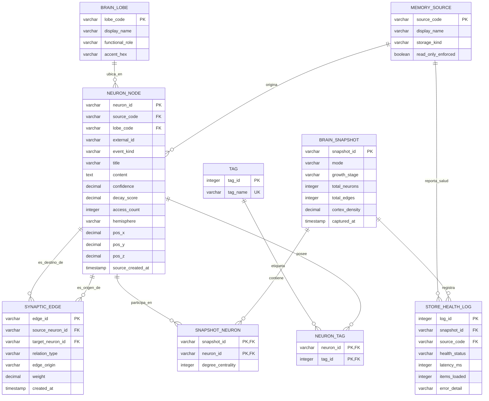

# Fase 2 — Diseño del Modelo de Datos (Conceptual, Lógico y Físico)

**Proyecto:** Neural Brain Visualizer (`neural-brain-visualizer`)  
**Versión:** 1.0.0  
**Fecha:** 2026-11-19  

---

## 1. Estrategia de Datos (Lectura Políglota + Esquema Analítico Normalizado)

El sistema ingiere en vivo desde tres almacenes heterogéneos locales en modo solo lectura:
1. **Grafo binario (`agentic-memory`)**: `.agentic-brain.amem` (nodos cognitivos + aristas tipadas + vector 128D).
2. **Vectorial + Historial (`mem0`)**: Qdrant local (384D) + SQLite `history.db`.
3. **Documental (`ecc-memory-vault`)**: archivos Markdown con frontmatter YAML (`ecc.memory.v1`).

Para estandarizar el dominio en memoria y soportar auditoría/telemetría histórica opcional (instantáneas del crecimiento cerebral en el tiempo), se formaliza el modelo de datos completo en 3 niveles (Conceptual, Lógico 3FN/BCNF y Físico SQL DDL/DML en `database/schema.sql` y `database/seeds.sql`).

---

## 2. Nivel Conceptual — Modelo Entidad-Relación (MER)

---

## 3. Nivel Lógico — Modelo Relacional y Normalización (1FN, 2FN, 3FN / BCNF)

### 3.1 Verificación de Formas Normales
- **Primera Forma Normal (1FN):** Todos los atributos son atómicos. Las etiquetas multivaluadas (`tags: string[]`) provenientes de `ecc-memory-vault` y categorías de `mem0` se descomponen en la tabla `tags` y la tabla asociativa `neuron_tags` (eliminando grupos repetitivos).
- **Segunda Forma Normal (2FN):** Todas las tablas con clave primaria compuesta (`neuron_tags`, `snapshot_neurons`) carecen de dependencias parciales; `degree_centrality` en `snapshot_neurons` depende de la clave compuesta completa `(snapshot_id, neuron_id)`.
- **Tercera Forma Normal (3FN) y BCNF:** No existen dependencias transitivas. Los metadatos visuales y descriptivos de cada región cerebral (`display_name`, `functional_role`, `accent_hex`) residen exclusivamente en `brain_lobes`, y los metadatos de cada motor origen residen en `memory_sources`. Cada determinante en todas las tablas es clave candidata (BCNF).

### 3.2 Resolución de Relaciones N:M y Propagación de FKs
1. `NEURON_NODE (N) <-> (M) TAG` resuelta mediante **`neuron_tags(neuron_id, tag_id)`** con `ON DELETE CASCADE`.
2. `BRAIN_SNAPSHOT (N) <-> (M) NEURON_NODE` resuelta mediante **`snapshot_neurons(snapshot_id, neuron_id)`** con `ON DELETE CASCADE`.
3. `NEURON_NODE (N) <-> (M) NEURON_NODE` (grafo sináptico) resuelta mediante **`synaptic_edges(edge_id, source_neuron_id, target_neuron_id, ...)`** con restricción `CHECK (source_neuron_id <> target_neuron_id)` para impedir auto-bucles sinápticos inválidos.

---

## 4. Nivel Físico — Tablas, Restricciones y Scripts SQL

El diseño físico está implementado de forma reproducible y compatible con SQLite 3 / PostgreSQL / MySQL 8 (estándar ANSI SQL) en:
- **DDL del Esquema:** [`database/schema.sql`](../database/schema.sql) — incluye `PRIMARY KEY`, `FOREIGN KEY` con políticas explícitas `ON DELETE` / `ON UPDATE`, `NOT NULL`, `UNIQUE`, `CHECK` (rangos `[0.0, 1.0]` para `confidence`, `weight` y `cortex_density`; validación de dominios cerrados para `hemisphere`, `mode`, `growth_stage` y `health_status`) e índices sobre columnas de consulta frecuente (`source_code`, `lobe_code`, `source_neuron_id`, `target_neuron_id`).
- **Semillas DML de Prueba:** [`database/seeds.sql`](../database/seeds.sql) — catálogos maestros de las 3 fuentes (`agentic-memory`, `mem0`, `ecc-memory-vault`), los 6 lóbulos anatómicos y un set reproducible de fixtures de prueba para validación de integridad referencial.
