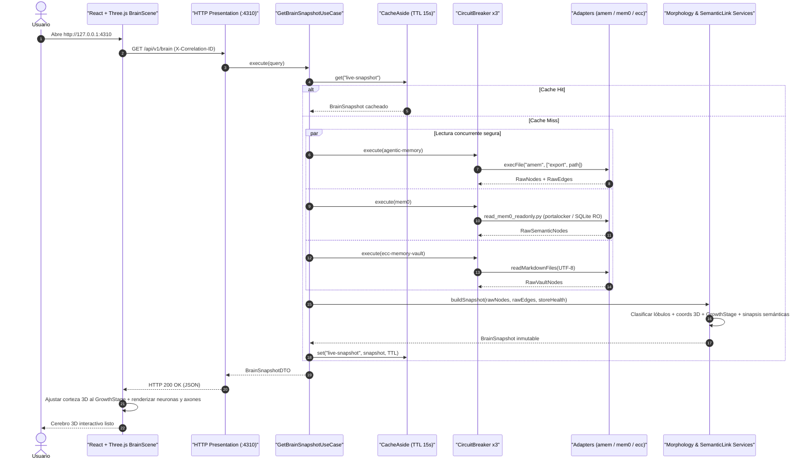
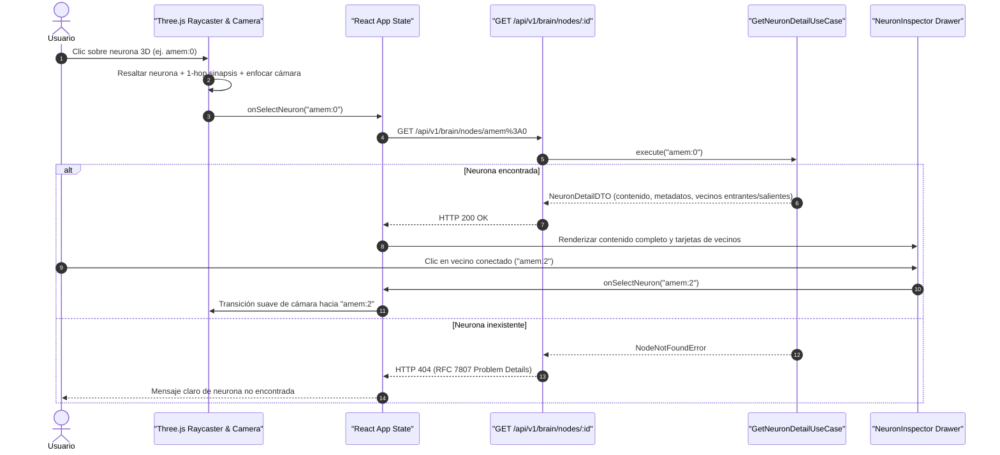
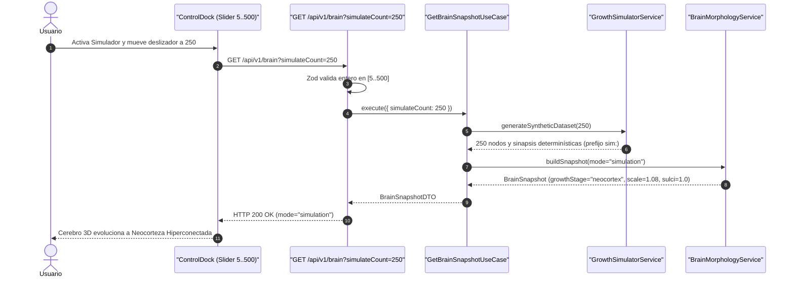
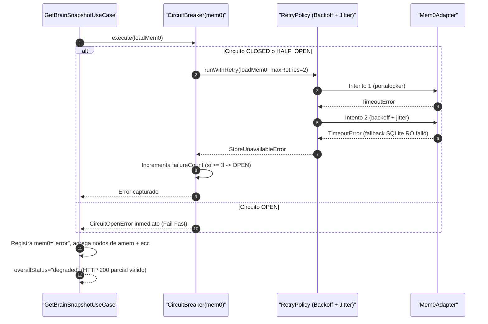

# Fase 2 — Diagramas Dinámicos UML (Secuencia y Flujos Críticos)

**Proyecto:** Neural Brain Visualizer (`neural-brain-visualizer`)  
**Versión:** 1.0.0  

---

## 1. Secuencia — Carga del Cerebro 3D en Vivo (Con Caché y Resiliencia)

---

## 2. Secuencia — Inspección Interactiva de una Neurona y Navegación Sináptica

---

## 3. Secuencia — Simulador de Crecimiento Cerebral (Sin Afectar Disco)

---

## 4. Secuencia — Degradación Elegante ante Fallo de Adaptador (Circuit Breaker)

